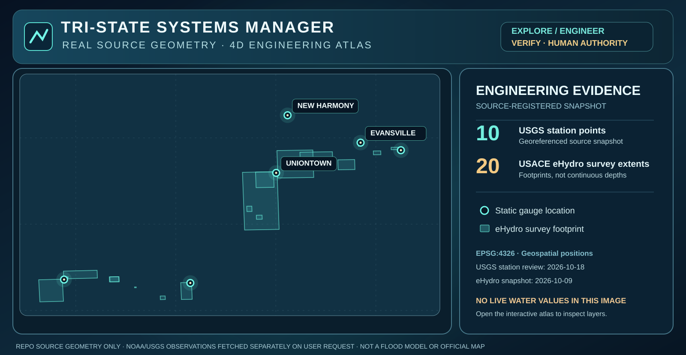

# TRI-STATE SYSTEMS MANAGER
### The Ohio–Wabash River Valley, seen in four dimensions

**A free, open-source digital twin and scientific engineering workbench for Indiana, Illinois, and Kentucky.** Explore the landscape, examine water and infrastructure, test explicitly defined scenarios, and follow every result back to its sources.

<p align="center">
  <a href="https://atphobia22.github.io/Tri-State-Systems-Manager/atlas/" title="Open the public 4D Atlas">
    
  </a>
</p>

> **Source-backed preview, not invented geography.** The SVG plots real georeferenced station points and survey footprints already committed in TSM. It is **not live telemetry**, a DEM, or proof of a validated simulation. The interactive [**4D Atlas**](https://atphobia22.github.io/Tri-State-Systems-Manager/atlas/) uses MapLibre, the geospatial data fabric, and the on-demand river board.

**[Launch the 4D Atlas](https://atphobia22.github.io/Tri-State-Systems-Manager/atlas/)** · **[Public console](https://atphobia22.github.io/Tri-State-Systems-Manager/)** · **[Cesium 4D twin](https://atphobia22.github.io/Tri-State-Systems-Manager/cesium/)** · **[Source](https://github.com/ATphobia22/Tri-State-Systems-Manager)** · **[Evidence standard](docs/architecture/ENGINEERING-ASSURANCE-STANDARD.md)** · **[Data sources](docs/DATA-SOURCE-CATALOG.md)** · **[Flood mapping eras](docs/flood/MULTI-AGENCY-FLOOD-MAPPING-ERA-TABLE-2026-11-14.md)** · **[CI](https://github.com/ATphobia22/Tri-State-Systems-Manager/actions)**

*Historical crest records can be explored offline in the Atlas. Live USGS readings use the public agency endpoint. Features backed by the TSM Node API need a configured service.*

---

## Recent features and functions on `main` (November 15, 2026)

`main` HEAD reference at documentation time: [`80d8279`](https://github.com/ATphobia22/Tri-State-Systems-Manager/commit/80d82795b0636a2673cb880fc26b9aba85570caa) and later README commits. These are **merged source capabilities**. Cinema and materials never replace observed gages, effective FIRMs, or human authority.

### Public web twin (MapLibre + Cesium)

| Feature | Function |
|---|---|
| **4D Atlas** | Explore / Engineer / Peer Review lenses; dynamic IN–IL–KY region labels; mobile navigation regression tests |
| **Cesium regional twin** | Multi-county context, USGS terrain fallback, partial Posey building meshes, cinematic flyover hooks ([#600](https://github.com/ATphobia22/Tri-State-Systems-Manager/pull/600)–[#608](https://github.com/ATphobia22/Tri-State-Systems-Manager/pull/608)) |
| **Mount Vernon flood screen** | Hypothetical NAVD88 water-surface comparison against Ohio River–connected terrain — **scenario**, not an issued determination |
| **River gauge board** | USGS-first live stage with sentinel auto-correct (−999), retries, snapshots, and quality labels (`ok` / `corrected` / `stale`) |
| **NFHL / data fabric** | Priority NFHL stack, metadata validators, evidence-gated layer selection |
| **Agency snapshots** | Retry/diagnostics for official endpoints; 3DEP discovery uses official PJSON metadata |

### Cinematic and asset plane

| Feature | Function |
|---|---|
| **Six evidence-gated film shots** | Contracted 4D scenarios with provenance gates and headless tests ([#605](https://github.com/ATphobia22/Tri-State-Systems-Manager/pull/605)) |
| **CC0 / license-gated intake** | Bounded stage with URL allowlist, independent digests, atomic receipts; rejects symlink roots and malformed HTTP metadata ([#603](https://github.com/ATphobia22/Tri-State-Systems-Manager/pull/603), [#604](https://github.com/ATphobia22/Tri-State-Systems-Manager/pull/604)) |
| **USPS Addresses adapter** | Server-only, disabled-by-default client with privacy/PII gates |
| **OpenUSD stage recipe** | Sublayers: geospatial → terrain → buildings → hydro → flood history → evidence → cinematic; variants for `heightQuality`, `lod`, `floodEvent`, `displayMode` (`packages/openusd/`) |

### Engineering trust and platform

| Feature | Function |
|---|---|
| **Engineering packages** | Survey, COGO, least-squares, LandXML, OpenMI notes, forecasting hooks, release-gates, approval-workflows |
| **Merkle / evidence ledger** | Append-only provenance with human-authority signing paths |
| **Release gates** | Soft labels (`SIMULATION_DEMO`, height unavailable, LOMA claim blocked)—not silent hard-stops on the public twin |
| **COPC / DEM recovery** | Multipart footprint roof sampling ([#580](https://github.com/ATphobia22/Tri-State-Systems-Manager/pull/580)); Posey DEM staging inventory ([#581](https://github.com/ATphobia22/Tri-State-Systems-Manager/pull/581)) |
| **UE5.8 native** | HLOD/physics gates, scene-layer visibility, offline build scripts ([#577](https://github.com/ATphobia22/Tri-State-Systems-Manager/pull/577)) — **Shipping proof still required** |
| **Multi-platform packaging** | Tauri desktop targets, Windows offline scripts, Linux AppImage/deb, iOS Capacitor notes; binary signing remains credential-gated |
| **Streaming research** | Optional evidence-gated tile priority planner; neural/quantum fixtures stay non-authoritative ([#599](https://github.com/ATphobia22/Tri-State-Systems-Manager/pull/599)) |

### Branches not yet on `main`

`fix/nwis-ogc-v1-migration`, `feat/geobim-source-evaluation-20261111`, `feat/mount-vernon-scene-layer-runtime-20261111`, and a Dependabot Actions branch remain separate until PR merge.

---

## Choose your view of the valley

| Journey | For whom | What you can discover | Current implementation boundary |
|---|---|---|---|
| **01 · EXPLORE** | Residents, students, families, new map users and older adults | Rivers, terrain, communities, roads, land, vocabulary and agency-linked context | Public mapping and layer code exists; the guided, simplified experience is a **UX target** |
| **02 · ENGINEER** | Students, planners, builders, scientists and engineers | Real MapLibre layers, site calculations, flood/placement screening and cinematic navigation | Engineering routes are linked; **complete 4D timeline, model calibration and native runtime acceptance remain separate gates** |
| **03 · PEER REVIEW** | Peer reviewers, surveyors, researchers and public agencies | Registered government GIS sources, adapter paths, authority classes, metadata, limitations and evidence links | Source contracts are wired; **live connectivity and regulatory/professional certification require independent verification** |

**One landscape. Multiple audiences. The same scientific honesty.**

## What makes this a 4D engineering twin?

**3D** connects terrain, buildings, parcels, infrastructure and water. **The fourth dimension is time:** the date of a measurement, the version of a data source and the time of a modeled scenario must remain distinct.

| Explore the world | Interrogate the engineering | Verify its trustworthiness |
|---|---|---|
| [MapLibre / Three.js console](tsm-console/) | [Native Unreal Engine 5.8 scene](tsm-native/) | [Engineering assurance standard](docs/architecture/ENGINEERING-ASSURANCE-STANDARD.md) |
| [3D Tiles and building workflows](scripts/geospatial/) | [Hydraulic evidence and simulation](docs/ENGINEERING-EVIDENCE-PIPELINE.md) | [Data source catalog](docs/DATA-SOURCE-CATALOG.md) |
| [Official data adapters](packages/government/) | [Geodesy and surveying](tools/survey/) | [Posey building-source verification](docs/engineering-development/POSEY-DRIVE-SOURCE-VERIFICATION-2026-11-09.md) |

### Read the map correctly

- **Observed:** named observation with source and timestamp; **derived:** calculation with documented inputs; **scenario:** model under declared assumptions; **regulatory:** issued by a competent authority.
- **LIVE, STALE, or SOURCE UNAVAILABLE** must stay visible. Missing heights or stages stay missing.
- FEMA effective flood-hazard information, Indiana DNR planning layers and simulated extents need distinct legends and provenance.
- Camera modes and cinematic lighting improve understanding; they must **never silently alter measurements**.

### Evidence snapshot — November 15, 2026

This is a dated engineering summary, **not** a live build-status badge.

| Workstream | Status established by linked evidence |
|---|---|
| Building geometry (Posey) | Drive-verified LOD1 archive (**~20,517 height-verified buildings**); heights **DERIVED** from LiDAR vs footprints; unbuilt = no verified height. Not LOD2/LOD3 or regulatory mesh accuracy |
| DEM / terrain | DEM recovery merged ([#581](https://github.com/ATphobia22/Tri-State-Systems-Manager/pull/581)); ion terrain may still error until a clean GeoTIFF is accepted; World Terrain is the public fallback |
| COPC roof sampling | Multipart footprint and interior-hole fixes merged ([#580](https://github.com/ATphobia22/Tri-State-Systems-Manager/pull/580)) |
| Cesium 4D twin | Regional view, Mount Vernon screening, cinematic playback, official 3DEP PJSON, render recovery on `main` |
| Cinematic film plane | Six evidence-gated shots, ASWF notes, license-gated CC0 intake, stage hardening on `main` |
| OpenUSD composition | Variant sets and stage recipe under `packages/openusd/` — scene description only, not FIRM truth |
| Native UE5.8 Shipping / offline Windows 11 | Source and scripts exist; **signed Shipping binary, air-gapped headed proof, and FPS/VRAM evidence remain required** |
| Peer review / authority | **Human-reviewed, source-specific:** no automatic FEMA determination, PE seal, or emergency instruction |

Inspect [main](https://github.com/ATphobia22/Tri-State-Systems-Manager/tree/main), [PRs](https://github.com/ATphobia22/Tri-State-Systems-Manager/pulls), [Actions](https://github.com/ATphobia22/Tri-State-Systems-Manager/actions), and original receipts. Docs alone do not prove CI green or a releasable native binary.

## Built for everyone, without sacrificing rigor

**Community first:** free public information; no required visitor account or paywall. **Professional review next:** formulas, datums, source dates and limits stay visible. **Offline where needed:** Windows 11 offline packaging is a target, not a claim that the signed installer is ready today.

> **Technology informs people. Human authority remains final.** TSM is decision-support software, not a substitute for official flood warnings, certified surveys, professional engineering judgment, sealed deliverables or regulatory determinations.

---

## Native Unreal Engine 5.8 application

[`TSMNative.uproject`](tsm-native/TSMNative.uproject) and the **TSMNative** C++ module support Mount Vernon / Point Township scenes alongside the public web console.

| System | Functionality |
|---|---|
| **Engineering HUD** | Slate-based runtime inspection and status controls |
| **World Partition** | Streaming prefetch when the active map supports it |
| **Engineering runtime** | Native calculation and inspection integration |
| **Scene layers** | Source-aware BUILDINGS / FLOODPLAIN / UTILITIES visibility; local save/load profiles |
| **Hydrology / flood** | Gage-datum validation, runoff/diffusion screening, elevation comparisons |
| **Geodesy / survey** | CRS transforms, NAVD88/GEOID18 evidence, COGO, LandXML, least-squares, earthwork quantities |
| **Evidence** | Manifests, checksums, provenance, missing-evidence states |

Build entry points: [`Build-TSMNativeWindows.ps1`](scripts/native/Build-TSMNativeWindows.ps1), [`Build-TSMShipping.ps1`](scripts/build/Build-TSMShipping.ps1). **A process surviving startup is not proof of correct graphics, scientific data or complete offline operation.**

The [Sovereign Deduplication Engine](crates/sovereign-dedup-engine/) is an offline Rust content-addressed store for reasoning-subgraph JSON and provenance—not a replacement for the authoritative engineering evidence ledger. See [SDE production integration](docs/native/SDE-PRODUCTION-INTEGRATION.md).

## 1. What TSM can do

| Capability | Everyday meaning | Foundation |
|---|---|---|
| **Interactive digital twin** | Terrain, rivers, roads, parcels, buildings, flood-related layers together | React/TypeScript, MapLibre, Three.js, source-aware layers |
| **Cinematic 3D scenes** | Landscape and infrastructure in 3D with camera tools | GLB/3D Tiles, UE5.8, Cesium contracts |
| **River observations** | Named stations, stages, flow, timestamps | USGS, NOAA NWPS, gage-datum validation |
| **Flood-hazard mapping** | Published flood info vs parcels, roads, structures, terrain | FEMA NFHL, Indiana DNR layers |
| **Rainfall and runoff** | Estimated runoff under declared assumptions | Hydrologic screening methods with provenance |
| **Evidence and review** | Trace results to sources and methods | Merkle ledger, soft release gates, human review |

## 2. Evidence classes

| Class | Meaning | Example |
|---|---|---|
| **Observed** | Measurement from a named source with time and units | USGS river stage |
| **Derived** | Computation with identified inputs and method | Calculated freeboard from survey LAG and BFE |
| **Scenario** | Model under explicit assumptions | Design-event flood depth |
| **Regulatory** | Decision issued by an authorized body | Effective FEMA map panel |

## 3. Quick start (web console)

```bash
git clone https://github.com/ATphobia22/Tri-State-Systems-Manager.git
cd Tri-State-Systems-Manager/tsm-console
npm ci
npm run dev
```

Open the local address printed by Vite. Optional checks:

```bash
npm run check:type
npm run build
```

Survey tooling:

```bash
python -m pip install -r tools/survey/requirements.txt
python -m unittest discover -s tests/survey -v
```

## 4. Public-interest use and contributions

TSM prioritizes free public access, traceable sources, accessible explanations, transparent science, and responsible human review.

[Contributing](CONTRIBUTING.md) · [Security](SECURITY.md) · [License](LICENSE) · [Issues](https://github.com/ATphobia22/Tri-State-Systems-Manager/issues)

**License:** Apache-2.0 for repository code, subject to third-party component and dataset terms.

**Scientific and regulatory use:** TSM is an information, research, and engineering decision-support system. It does not replace a licensed survey, sealed engineering deliverable, official flood warning, or authorized agency decision.

---

**In memory of Beverly Ann Tucker.**
