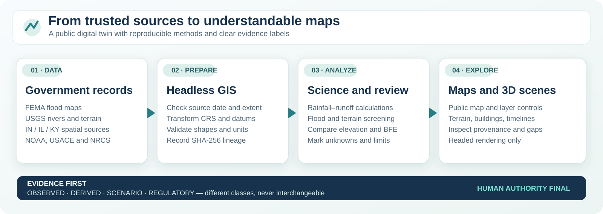
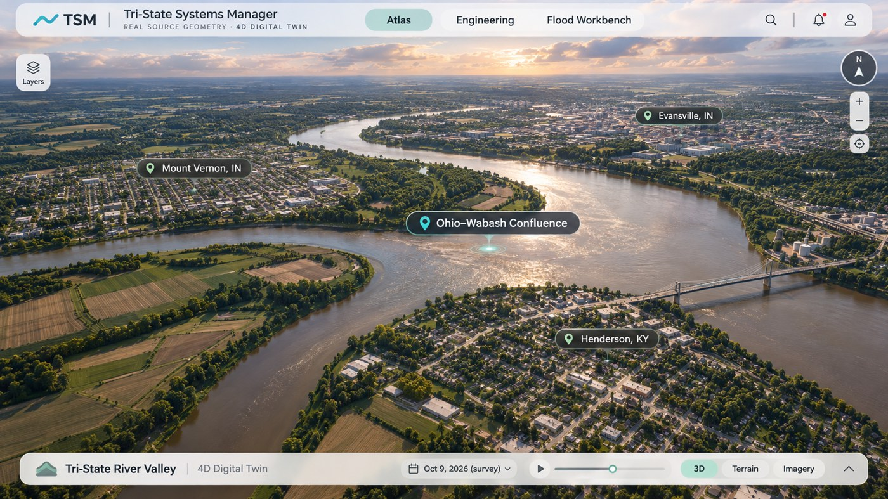
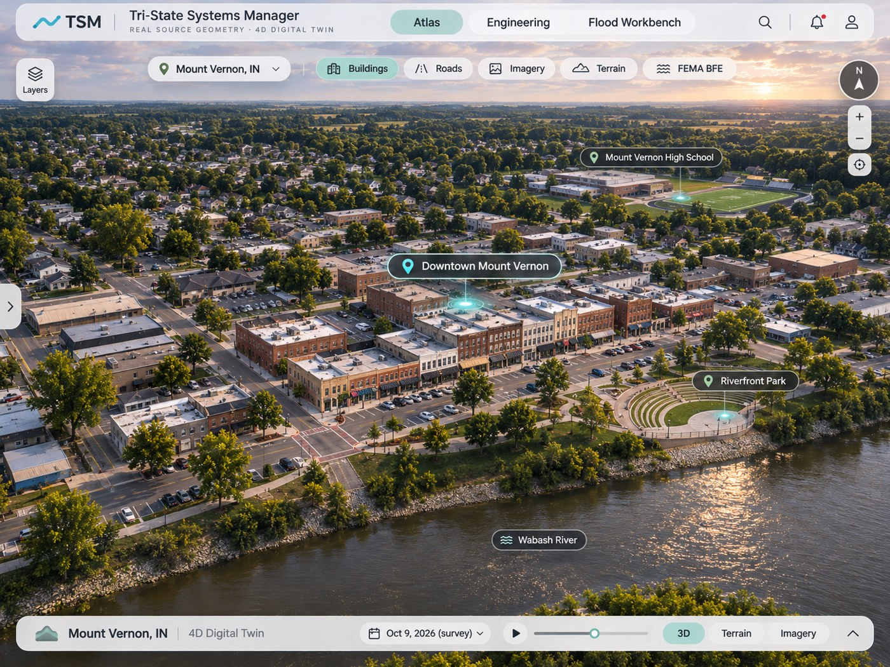
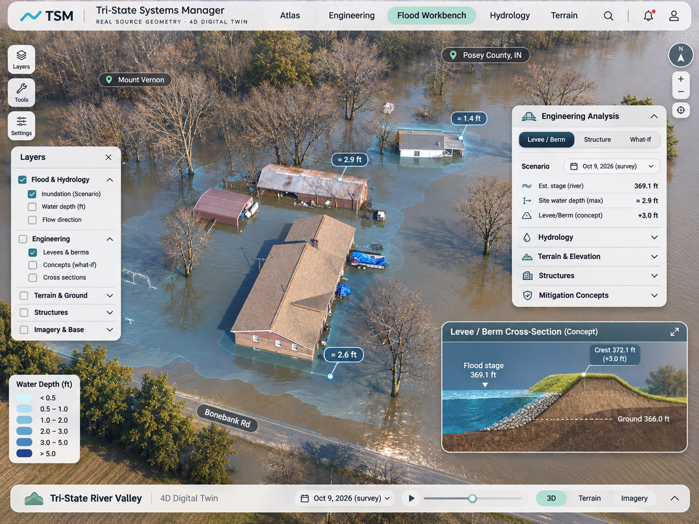

# Tri-State Systems Manager
### Explore the Ohio–Wabash River Valley in 4D

**A free, public-interest digital twin for Indiana, Illinois and Kentucky.** A digital twin is a computer-based view of a real place. **4D** means we can explore **3D space plus time**: terrain, roads, buildings, rivers and the dates of maps, observations, historical records and hypothetical engineering scenarios.

Built with local communities in mind, **Tri-State Systems Manager (TSM)** helps people learn about their landscape and helps engineers examine source data, calculations and uncertainty. **Mount Vernon and Posey County, Indiana are the best-developed local focus**, not proof of complete coverage in every county.

**Free to explore · No account for public viewing · Open-source code · Human authority final**

  

Conceptual system diagram — not a claim that every listed source or scientific model is currently deployed or validated.

  <a href="https://atphobia22.github.io/Tri-State-Systems-Manager/"><strong>Open public console</strong></a>
  &nbsp;·&nbsp;
  <a href="https://atphobia22.github.io/Tri-State-Systems-Manager/atlas/"><strong>Explore the 4D Atlas</strong></a>
  &nbsp;·&nbsp;
  <a href="https://atphobia22.github.io/Tri-State-Systems-Manager/cesium/"><strong>View Cesium scene</strong></a>
  &nbsp;·&nbsp;
  <a href="https://github.com/ATphobia22/Tri-State-Systems-Manager/actions"><strong>Inspect build evidence</strong></a>

> **Important:** This is a community mapping, research and **engineering-screening** platform. It is **not** an emergency warning system, a licensed survey, a FEMA flood-map determination, a certified hydraulic model, or an automatic government filing tool. Always consult the issuing government source and authorized professionals for decisions that affect safety, property or regulations.

## Start here: choose your path

| I am a… | A useful first step | Where to read more |
|---|---|---|
| **Resident, family member or student** | Open the map, find a river or town, show/hide available layers, and look at the source and date labels. | [What 4D means](#1-what-4d-means-and-who-it-serves) · [Map functions](#2-feature-and-function-catalog) |
| **Local planner or community organization** | Explore flood, infrastructure and environmental *screening* context and look for official sources before planning a project. | [Government source guide](#3-government-source-authority-map) · [Grant research](#5-the-47620--posey-county-grant-matrix) |
| **Engineer, GIS analyst or surveyor** | Check horizontal CRS, height datum, data vintage, assumptions, formulas, units and model boundaries. | [Math and science](#4-math-and-science-what-the-calculations-actually-mean) · [Datum method](docs/geodesy/DATUMS.md) |
| **Independent researcher or reviewer** | Pin the exact commit, data hashes, CI run and source IDs; reproduce tests and document unresolved evidence. | [Release proof](#6-public-release-proof-remaining-gaps-and-honest-status) · [Peer-review checklist](docs/release/PEER-REVIEW-READINESS-2026-11-16.md) |
| **Developer or contributor** | Run the public console locally and inspect the scientific and geospatial modules. | [Quick start](#7-quick-start-and-independent-reproduction) · [Contributing](CONTRIBUTING.md) |

### What can I do with TSM?

| Capability | What it means in everyday language | Evidence status |
|---|---|---|
| **2D/3D maps and 4D scenes** | Explore rivers, roads, terrain, mapped buildings, layer controls and selected time contexts. | Source code and browser tests exist; coverage varies by layer. |
| **Flood and river context** | Compare official flood-map *references* with river-stage context and clearly labeled hypothetical scenarios. | FEMA/USGS adapters and screening code exist; not a flood-warning or regulatory determination. |
| **Rainfall, runoff and flood screening** | Study how a modeled storm may produce surface runoff and simplified water movement. | Algorithms and tests exist; site calibration and acceptance are separate. |
| **Buildings, parcels and infrastructure** | Inspect spatial relationships and building representations where actual source data is available. | Partial local data; **22,815** published height-linked Posey features vs **23,082** target in the dated release audit. |
| **Environmental and wetland research** | Find potential NWI wetlands and other environmental source records for further investigation. | Official [USFWS NWI data source](https://www.fws.gov/program/national-wetlands-inventory/data-download) researched; **not yet a validated, ingested TSM wetland overlay**. |
| **Engineering evidence** | See what came from an agency, what was calculated, what was simulated and what is missing. | Provenance schemas, manifests, hashes and validation gates exist; source completeness is not assumed. |
| **Community funding research** | Find possible grant programs and the documentation a qualified sponsor may need. | Planning matrix exists; deadlines and eligibility must be checked against current notices. |
| **Native and offline development** | Prepare local datasets and test Windows/macOS/Linux/iOS and native 3D pipelines. | Platform code and CI workflows exist; a clean offline UE5.8 Windows Shipping acceptance is **not independently established**. |

**Ohio–Wabash river twin pilot.** The [river evidence workflow](docs/hydrology/OHIO-WABASH-RIVER-TWIN.md) captures USGS gauge data for Evansville and New Harmony and supports offline replay against operator-reviewed HEC-RAS results.

### The eight-county exact-boundary work area

TSM's [eight-county configuration](data/regional/eight-county-exact-spatial-validation-v1.json) identifies **eight counties in three states**. It requires source features to match or intersect **actual county polygons** instead of relying on a rough bounding box. **A county in the configuration does not mean all its parcels, roads, buildings, LiDAR or flood layers have been downloaded or verified.**

| State | County | Census GEOID / FIPS | Role |
|---|---|---|---|
| **Indiana** | **Posey** | `18129` | Primary Mount Vernon / local demonstration focus |
| Indiana | Vanderburgh | `18163` | Regional validation area |
| Indiana | Gibson | `18051` | Regional validation area |
| Indiana | Warrick | `18173` | Regional validation area |
| **Illinois** | White | `17193` | Cross-river validation area |
| Illinois | Gallatin | `17059` | Confluence-area validation |
| **Kentucky** | Henderson | `21101` | Cross-river validation area |
| Kentucky | Union | `21225` | Cross-river validation area |

Other nearby communities or river reaches may appear in regional scenes and research catalogs, but they are not silently added to this **eight-county exact-boundary contract**.

## Visual tour of the project

These **three images are future-state design concepts** for the envisioned Unreal-powered Tri-State 4D open world and its public web companion. They are generated illustrations informed by regional geography and the project UI, **not screenshots, geodetic reconstructions, measured flood simulations, confirmed building materials, or evidence that all 3D details are already deployed**.

  

<strong>01 · Regional 4D open world</strong> — seamless-looking imagery, terrain, waterways, communities and compact map-first navigation. Design concept, not an actual runtime capture.

<table>
  <tr>
    <td width="50%" align="center"></td>
    <td width="50%" align="center"></td>
  </tr>
  <tr>
    <td><strong>02 · Mount Vernon building detail</strong> — desired roof geometry, materials and more open viewport space; detailed meshes must be validated before these visuals can be claimed as actual coverage.</td>
    <td><strong>03 · Flood and levee science</strong> — hypothetical engineering scenarios, future cross-sections and expandable analytical tools. <em>Not a forecast, survey or accepted safety factor.</em></td>
  </tr>
</table>

For audited geospatial reference rather than concept art, inspect the [source-derived regional overview](docs/assets/tsm-source-backed-atlas.svg), its documented source data, and the [public Cesium view](https://atphobia22.github.io/Tri-State-Systems-Manager/cesium/). Design concepts do not substitute for actual browser screenshots or clean Windows Unreal Shipping evidence.

## Software and platforms at a glance

| Platform | Technologies / project location | Availability and proof |
|---|---|---|
| **Public web (desktop, tablet, phone)** | [React, TypeScript, Vite, MapLibre, Cesium](tsm-console/) | GitHub Pages console and visual tests; some layers need online agency sources or configured services. |
| **Geospatial and scientific processing** | [Python and GIS scripts](scripts/geospatial/), [scientific code](tsm-console/src/lib/), [government adapters](packages/government/) | Designed for **headless** ingestion, calculations, provenance and CI; exact dataset validity varies. |
| **Windows desktop packaging** | [Tauri](tsm-console/src-tauri/) and [desktop workflow](.github/workflows/tsm-desktop.yml) | Cross-platform packaging workflows exist; this is different from the UE5.8 native Shipping release. |
| **Windows 11 native 3D** | [Unreal Engine 5.8 / C++](tsm-native/) and [native build scripts](scripts/native/) | Source and build automation exist; do **not** infer an independently verified, air-gapped Windows Shipping executable. |
| **iPhone/iPad research client** | [Swift/SceneKit operator app](apps/ios-operator-cinematic/) | iOS project and tests exist; no App Store availability is claimed. |
| **macOS and Linux package targets** | [Tauri desktop matrix](.github/workflows/tsm-desktop.yml) | CI packaging targets; installed-device acceptance and distribution are separate. |

### The math and science behind the pictures

| Scientific discipline | Method represented in source | Why it matters |
|---|---|---|
| **Hydrology** | USDA NRCS Curve Number rainfall–runoff relation | Estimates a *scenario's* surface runoff, not a measured river flood. |
| **Hydraulics** | Simplified finite-difference, Manning-based 2D diffusion-wave screening | Experiments with shallow water spreading; not full Saint-Venant/HEC-RAS regulatory validation. |
| **Surveying and geodesy** | CRS conversion, US survey foot conversion, NAVD88, geoid separation, station-specific gage zero | Prevents comparing elevations from incompatible reference systems. |
| **Accuracy and uncertainty** | Horizontal/vertical RMSE against supplied independent checkpoints | Quantifies disagreement **only when independent measured data are provided**. |
| **Terrain and earthwork** | Cell-area × elevation-change cut/fill sums | Estimates hypothetical excavation and fill on compatible elevation grids. |
| **Risk and economics** | Screening depth–damage curves and supported benefit–cost inputs | Organizes possible impacts without claiming FEMA-approved losses or grant eligibility. |

The formulas, limitations and code links are in [Section 4](#4-math-and-science-what-the-calculations-actually-mean).

### Government data and who has authority

**Primary source families in the repository's code, records or workflows** include [FEMA](https://msc.fema.gov/) (effective flood maps), [USGS](https://waterdata.usgs.gov/) (river observations), [USGS 3DEP](https://www.usgs.gov/3d-elevation-program) (terrain/LiDAR), [Indiana GIO/IndianaMap](https://www.indianamap.org/) (state GIS), [Indiana DNR](https://www.in.gov/dnr/water/) (state floodplain information), [USACE](https://www.nld.usace.army.mil/) (levees/hydrographic resources), [NOAA NWS](https://www.weather.gov/) (weather and river forecasts), [NOAA NGS](https://geodesy.noaa.gov/) (datum/geodesy), [US Census Bureau](https://www.census.gov/geographies/mapping-files/time-series/geo/tiger-line-file.html) (boundary geography), [USDA NRCS](https://websoilsurvey.nrcs.usda.gov/) (soils), and [EPA](https://echo.epa.gov/) (environmental facility context).

**Additional discovery and candidate sources**, including Illinois and Kentucky statewide GIS, Indiana Geological and Water Survey, NASA, USDA NAIP and the **[USFWS National Wetlands Inventory](docs/geospatial/USFWS-NWI-WETLANDS-AND-MAP-UX-2026-11-17.md)**, must **not** be described as ingested or live merely because they are linked or registered. See the [complete agency/source authority table](#3-government-source-authority-map) and [catalog](docs/DATA-SOURCE-CATALOG.md).

### Four words that matter

| Label | Plain-language definition |
|---|---|
| **OBSERVED** | A dated measurement or agency record, with its source identified. |
| **DERIVED** | A result calculated from identified inputs and a stated method. |
| **SCENARIO** | An illustrative what-if model with assumptions, not a forecast. |
| **REGULATORY** | An actual decision or action issued by an authorized agency; **TSM never manufactures this status**. |

### Current code versus independently verified release evidence

**Documentation updated November 17, 2026.** This README update is based on [main commit `57e349fc5c375384893d22de68ddb9840f3abb77`](https://github.com/ATphobia22/Tri-State-Systems-Manager/commit/57e349fc5c375384893d22de68ddb9840f3abb77), which includes the [map-first redesign PR #632](https://github.com/ATphobia22/Tri-State-Systems-Manager/pull/632). On that PR, the Parse Gate and headed Chrome UI interactions passed. **Always consult the current [main Actions runs](https://github.com/ATphobia22/Tri-State-Systems-Manager/actions) for the newest status.**

The detailed scientific/production receipt below is intentionally **frozen to November 16, 2026** and its immutable release commit. It describes that release's proof, **not** every later push or every deployed file. Missing bathymetry, independently verified checkpoints, complete Posey building heights, regulatory approvals and clean offline UE5.8 Shipping acceptance remain separate evidence gates.

---

## Technical reference, reproducibility and peer review

These sections preserve implementation paths, scientific equations, source authority, release provenance and reproduction steps. Readers can stop after the guide above; engineers and reviewers can continue into the evidence.

## 1. What 4D means, and who it serves

The **3D** dimensions are spatial terrain, buildings and infrastructure. The **fourth dimension is time**, with distinct fields for **observation time**, **imagery acquisition**, **map effective date**, **source publication**, **ingestion timestamp**, **historical replay time** and **simulation time**. TSM does not mislabel archival snapshots as live measurements, model results as observations or a nominal 3D representation as measured LoD4 architecture.

| Audience | Practical use | Authority limit |
|---|---|---|
| **Public, schools and communities** | Explore roads, rivers, local layers, source timelines, and 3D valley scenes | The viewer does not replace official alerts, warnings or evacuation guidance |
| **Planners and local sponsors** | Inspect candidate drainage/land/road risk, prepare evidence packets, research grant programs | Sponsor eligibility, funding, environmental and regulatory decisions remain external |
| **Engineers, GIS users and surveyors** | Review CRSs/datums, site elevation comparisons, numerical methods, data products, provenance and validation scripts | No automated professional certification or land-boundary determination |
| **Peer reviewers and researchers** | Reproduce code/fixture tests, audit manifests, inspect agency source IDs, check unsupported claims | Independent measured inputs, uncertainty and human scientific review are still necessary |

**Access policy:** no user login or paywall for public viewing. Privileged actions and professional filings require their own authorization. Offline-first native release work is separate from the public web delivery.

## 2. Feature and function catalog

The following lists **implemented modules and documented integrations**, with distinctions between code existence, deployed function and external acceptance. It is not a claim that every optional plugin, solver, GIS feed or hardware target works in every environment.

### Public visual and geographic surfaces

| System | Functions available in source | What remains conditional |
|---|---|---|
| [React / MapLibre 4D Atlas](tsm-console/) | Map layers, geographic and time context, Explore / Engineer / Peer Review lenses, river board, mobile navigation, source/quality labels | Some live/API routes need reachable public agency services or a separately configured server |
| [Cesium regional scene builder](scripts/geospatial/build_cesium_regional_scene.py) | Regional terrain/road scene assets, observations and historical replay, scenario-screening layers, static Pages publication | Coverage is not universal; terrain/bathymetry must be verified per product; some visual layers use fallback |
| [Building 3D Tiles and geospatial processing](scripts/geospatial/) | Posey footprint acquisition, elevation/roof sampling, identity/geometry checks, partial height-bearing building records, HLOD/tileset pipeline scripts | **23,082** footprint-to-height completeness not yet proven; LoD2/3/4 façade/roof meshes are not independently certified |
| [Mount Vernon scene](scripts/geospatial/build_mount_vernon_scene.py) | Local official footprint and roadway staging | Staged geometry is not independently surveyed cadastral or construction geometry |
| [Cinematic playback / renderer checks](tsm-console/cypress/cesium/) | Camera scenes, visual regression, headed Chrome checks, asset availability, lighting presentation | Lighting/camera motion does not establish hydraulic accuracy; browser render proof is not UE Shipping proof |
| [OpenUSD composition](packages/openusd/) | Geospatial/terrain/building/hydro/flood/evidence/cinema sublayers and display/quality variants | Composed visuals do not become an official geospatial determination |

### Science and engineering modules

| Module | Key function | Explicit limitations |
|---|---|---|
| [Rainfall-runoff](tsm-console/src/lib/hydrology-runoff.ts) | USDA NRCS SCS Curve Number method; event hyetograph to runoff depth and interval cfs | Lumped CN assumptions, no baseflow, channel routing or event calibration |
| [2D flood spreading](tsm-console/src/lib/hydraulics-diffusion2d.ts) | Explicit finite-difference zero-inertia diffusion wave; Manning-based face fluxes; stability check | Not full Saint-Venant, supercritical shock, culvert network, or validated flood-frequency map |
| [Scenario runner](tsm-console/src/lib/scenario-runner.ts) | Runs hydrologic/hydraulic screening chain; labels unknown alerts as unknown | Scenario forcings/initial and boundary conditions need independent evidence |
| [Depth-damage](tsm-console/src/lib/hazus-depth-damage.ts) | Occupancy-based interpolated damage **screening** with model provenance | Not a FEMA-certified loss estimate or approved benefit–cost analysis |
| [Elevation and survey](tools/survey/) · [datum method](docs/geodesy/DATUMS.md) | COGO / surveying interoperability, explicit ftUS and metre conversion, vertical-datum provenance and gage-zero policy | Coordinate metadata ≠ independent field control; different geoid models must not be silently merged |
| [Independent checkpoints](scripts/geospatial/independent_checkpoint_accuracy.py) | Offline horizontal/vertical RMSE of actual supplied independent checkpoints; optional hash-pinned source/survey/coordinate operations | Produces **COMPUTED_UNCERTIFIED**, not field measurements or a survey certificate |
| [Hydraulic project evidence chain](docs/ENGINEERING-EVIDENCE-PIPELINE.md) | Terrain → submerged bathymetry → datum → baseline → calibration → scenarios → cut/fill → environmental review → BCA → independent QA | A documented adapter for HEC-RAS/OpenMI/other solvers is not a completed calibrated project |
| [FEMA and government fabric](packages/government/) | Source-capability registry, USGS/NOAA/FEMA/USACE/EPA/Census/NRCS adapters, PostGIS-oriented geodata and provenance contracts | Endpoint discovery/JSON parsing ≠ source validity, live availability or complete spatial coverage |
| [Evidence assurance](docs/architecture/ENGINEERING-ASSURANCE-STANDARD.md) | Classifies OBSERVED / DERIVED / SCENARIO / REGULATORY, maintains checksums and error/unknown/partial states | SHA-256 demonstrates byte identity, **not** scientific correctness |

### Native applications, rendering and infrastructure

| Path | Purpose | Status boundary |
|---|---|---|
| [Unreal Engine 5.8 C++ app](tsm-native/) | Engineering HUD, scene visibility, World Partition streaming hooks, terrain/building render integration, local data and build recipes | Signed, packaged, **offline clean Windows 11 x64 UE5.8 Shipping startup** with headed FPS/VRAM/hardware evidence must be independently demonstrated |
| [Windows build](scripts/native/Build-TSMNativeWindows.ps1) / [Shipping build](scripts/build/Build-TSMShipping.ps1) | Scripted compilation/cook/staging and installer paths | Presence of scripts or green desktop CI is not the complete native acceptance test |
| [iOS operator](apps/ios-operator-cinematic/) | Scene/observation/operator code paths and offline world-package concepts | Do not conflate iOS source with App Store release acceptance |
| [Data acquisition manifests](data-sources/manifests/) and [geospatial scripts](scripts/geospatial/) | Headless downloads, deterministic transformation, validation, raster/vector integration, SHA-256 receipts | Historical snapshots and endpoint inventories are not fresh live observations |
| [CI workflows](.github/workflows/) | Source gates, unit/type tests, data quality, static build, browser visuals and release checks | Each workflow proves **only** the checks it actually executed |

**Runtime design:** ingestion, transforms, science, QA, packaging and CI run **headlessly**; intentionally headed graphics and visual acceptance run in a renderer. Failures are scoped: a missing source shows **STALE**, **SOURCE_UNAVAILABLE**, partial or unverified evidence and should not silently manufacture a value or shut down unrelated safe operations.

---

## 3. Government-source authority map

TSM aggregates official U.S. federal and state records; however, **“registered,” “adapter available,” “downloaded,” and “rendered on public Pages” are four different states**. Every real claim should identify the actual service/layer ID and acquisition receipt.

The [new federal geology, USGS FSP/LBS and IN/IL/KY professional authority crosswalk](docs/geospatial/GEOSCIENCE-AUTHORITY-2026-11-16.md) separates current standards and scientific review policy from state licensing. The [FGDC/Tri-State machine registry](data/tsm-fgdc-tristate-geospatial-registry-v1.json), [full data-source catalog](docs/DATA-SOURCE-CATALOG.md), [FGDC catalog notes](docs/DATA-SOURCE-CATALOG-FGDC-TRISTATE-2026-11-15.md), [government adapter code](packages/government/src/adapters/) and [acquisition manifests](data-sources/manifests/) are the auditable inventories. The registry also catalogs *candidates* that have not been verified for this scene.

### Principal source families represented by code, snapshots or data workflows

| Authority (official access) | Dataset/service/use | Scientific/authority boundary |
|---|---|---|
| **[FEMA MSC](https://msc.fema.gov/)** / [NFHL REST](https://hazards.fema.gov/arcgis/rest/services/public/NFHL/MapServer) / OpenFEMA | FIRM/NFHL panels and flood zones, BFEs, flood map changes and history | Effective FIRM/FIS/map-change source controls; a TSM visualization is **not** FEMA's official determination |
| **[USGS Water Data](https://waterdata.usgs.gov/)** / [modern OGC water API](https://api.waterdata.usgs.gov/ogcapi/v1/) | Named gages, stage, discharge, site and observation times | Stage remains gage-relative until the specific gage zero/datum is evidenced |
| **[USGS National Map / 3DEP](https://apps.nationalmap.gov/)** | LiDAR/DEM, land elevations, National Map data and topographic discovery | Coverage, DEM vintage, vertical datum, grid/geoid/nodata and resolution vary per product |
| **[Indiana GIO / IndianaMap](https://www.indianamap.org/)** / [Elevation Hub](https://elevation.gio.in.gov/) | Posey imagery, footprints, road framework, parcels (including 2025 framework), elevations | Cadastre and building footprints are not survey certificates or finished roof models |
| **[Indiana DNR / INFIP](https://www.in.gov/dnr/water/)** | Best Available Flood Hazard / floodplain portal / FARA planning context | Keep state planning products **separate from effective federal NFIP FIRM authority** |
| **[USACE NLD](https://www.nld.usace.army.mil/)** / [HEC-RAS](https://www.hec.usace.army.mil/software/hec-ras/) / eHydro | Levee and navigation/bathymetry context; modeling interoperability | A levee outline is not proof of protection, and a solver interface is not a calibrated model |
| **[NOAA NWS](https://www.weather.gov/)** / [NWPS](https://water.noaa.gov/) | Flood forecasts, station and emergency/weather context | Forecasts, warnings, past readings and modeled scenarios must remain distinct |
| **[NOAA NGS](https://geodesy.noaa.gov/)** | NSRS, benchmark and vertical-datum references, geoid models | NAVD88, NGVD29, GEOID12B/18 and ellipsoid heights are not interchangeable |
| **[US Census TIGER/Line](https://www.census.gov/geographies/mapping-files/time-series/geo/tiger-line-file.html)** | Roads, jurisdiction boundaries and demographic/cartographic geography | Reference geometry, not parcel-boundary survey |
| **[USDA NRCS](https://websoilsurvey.nrcs.usda.gov/)** | SSURGO soils, hydrologic context and curve-number related source attributes | Soil map unit/land cover/season and hydrology assumptions need ground checks |
| **[EPA ECHO](https://echo.epa.gov/)** | Environmental compliance and facility reference adapter | Contextual source, not proof of a current permit or regulatory compliance |

### Other official agency candidates and registered research sources

The discovery and government-adapter registries additionally include **[Illinois State Geological Survey / ILHMP](https://clearinghouse.isgs.illinois.edu/)** (LiDAR, DEM, geology), **[Kentucky KyFromAbove](https://kyfromabove.ky.gov/)** (LiDAR, imagery, DEM), **[Indiana Geological and Water Survey](https://igws.indiana.edu/)**, **[USDA FSA NAIP](https://naip-usdaonline.hub.arcgis.com/)**, **[USFWS NWI](https://www.fws.gov/program/national-wetlands-inventory/data-download)** ([documented discovery and safe ingestion plan](docs/geospatial/USFWS-NWI-WETLANDS-AND-MAP-UX-2026-11-17.md); not yet an ingested wetland overlay), **[EPA EnviroAtlas](https://www.epa.gov/enviroatlas)**, **[NASA Earthdata](https://www.earthdata.nasa.gov/)** and NASA POWER, **[BLM land records](https://www.blm.gov/services/land-records)**, **[NPS GIS](https://www.nps.gov/subjects/gisandmapping/)**, **[NOAA Coast Survey](https://nauticalcharts.noaa.gov/)**, **[USDOT BTS](https://www.bts.gov/)**, **[HUD USER](https://www.huduser.gov/)**, and **[HRSA](https://data.hrsa.gov/)**. These are **not automatically loaded** into the public scene.
**Historical geologic-map context:** Six official Indiana University/IGWS records—including Henry H. Gray's 1987 statewide bedrock map, 1989 Quaternary map and 1970 Vincennes regional map—are recorded in the [historical geologic bibliography](data/fabrics/geological/gray-historical-publications-2026-11-16.json) with a [source/rights peer-review note](docs/geology/HENRY-H-GRAY-REVIEW-2026-11-16.md). These are **citation-only references**: no original map pixels, georeferenced boundaries, underground conditions or parcel survey data have been acquired from them. USGS 2025 rev. A LiDAR classes 21/22 and conditional class-21 DEM sourcing are now covered in the [classification guide](docs/geodesy/LIDAR-CLASSIFICATION.md). 

Catalog discovery references **[FGDC](https://www.fgdc.gov/)**, **[GeoPlatform](https://www.geoplatform.gov/)** and **[Data.gov](https://catalog.data.gov/)**. A catalog entry does not establish either upstream or downstream licensing, data quality or operational availability.

**Minimum per-dataset record for review:** source agency, dataset/product, service/layer ID, geography and extent, effective/acquisition/publication/retrieval dates as different fields, source license, horizontal CRS/EPSG, coordinate epoch, vertical datum/geoid, axis order, units, grid resolution, nodata, source/transformed file hashes, transformation lineage, validation class and missing-evidence reason. **Unknown must remain unknown**.

### Historical Indiana geological publication archive

The [historical geology source browser](https://atphobia22.github.io/Tri-State-Systems-Manager/geology-sources.html) presents nine curated Indiana Geological Survey / IU ScholarWorks bibliographic records for Posey County, the Lower Wabash, and Gray's statewide geological work. [Source catalog](data/fabrics/geological/igws-scholarworks-priority-v1.json) and [source/license limits](data/fabrics/geological/SCHOLARWORKS-PRIORITY-2026-11-16.md) distinguish historical interpretation from currently surveyed terrain and geology. PDFs are **not mirrored**; noncommercial/conflicting source rights remain for human review. The public page requires a successful corresponding GitHub Pages deployment; do not infer public availability from source files alone.

---

## 4. Math and science: what the calculations actually mean

The methods below summarize the **source implementations**. A formula can be dimensionally correct and the project still lack the site survey, boundary conditions or calibration necessary for engineering acceptance.

### A. Rainfall → runoff (USDA NRCS SCS Curve Number)

For rainfall \(P\) in **inches**, curve number \(0<CN\le100\):

\[
S=\frac{1000}{CN}-10,\qquad I_a=0.2S,\qquad
Q(P)=\begin{cases}0,&P\le I_a\\
\frac{(P-I_a)^2}{P-I_a+S},&P>I_a.\end{cases}
\]

**Meaning:** assumed initial rainfall abstraction precedes estimated direct runoff. The implementation differences cumulative runoff between supplied time intervals and converts **inches/hour × square miles** to **cfs** with factor **645.33**. See [runoff method](tsm-console/src/lib/hydrology-runoff.ts). This is **lumped, event-based and unrouted**—not a measured Wabash/Ohio hydrograph.

### B. Simplified 2D flood spreading

The [diffusion-wave implementation](tsm-console/src/lib/hydraulics-diffusion2d.ts) moves cell water by Manning-based face flux and finite-difference mass balance. It checks the explicit timestep against the coded approximation:

\[
\Delta t \le \frac{\Delta x^2}{4 D_{\max}},\quad
D\approx\frac{h_{\mathrm{flow}}^{5/3}}{n\sqrt{|S_w|}}
\]

with roughness \(n\), flow depth \(h_{\mathrm{flow}}\) and local water-surface slope \(S_w\). It uses closed domain edges and does **not** solve full momentum, dam-break shocks, sewer pressure, sediment or river bathymetry. **Passing a timestep bound is numerical stability evidence, not calibration or regulatory acceptance**. For full hydro-project acceptance see [engineering evidence pipeline](docs/ENGINEERING-EVIDENCE-PIPELINE.md).

### C. Elevation, flood clearance and geodesy

\[
WSE_{NAVD88} = \mathrm{observed\ gage\ stage} + \mathrm{verified\ NAVD88\ station\ zero}
\]

\[
\mathrm{floor\ freeboard}=FFE_{NAVD88}-BFE_{NAVD88},\quad
\mathrm{crest\ clearance}=\mathrm{berm\ crest}_{NAVD88}-BFE_{NAVD88}
\]

**Meaning:** gage stage is not sea-level elevation; use the *station-matched* verified zero, units and epoch before comparing it with a regulatory BFE or a property floor. BFE must come from the correct effective study/location. Any example values elsewhere in TSM are **site- and source-specific**, not universal regulatory thresholds.

For a compatible geoid and reference frame \(h=H+N\): ellipsoid height \(h\), orthometric height \(H\), geoid separation \(N\). **EPSG:2966 is Indiana West in US survey feet** (1 ftUS = 1200/3937 m); it is not a metre-based coordinate system. Some 2020 Indiana elevation data declare **GEOID12B**, which must never be silently relabeled GEOID18. See [geodetic assumptions and unresolved gage conflicts](docs/geodesy/DATUMS.md).

### D. Independent positional accuracy against real checkpoints

For independently obtained and correctly transformed **metre-based** checkpoint residuals \(\Delta x_i,\Delta y_i,\Delta z_i\):

\[
RMSE_{H1}=\sqrt{\frac1n\sum_{i=1}^n(\Delta x_i^2+\Delta y_i^2)},\qquad
RMSE_{V1}=\sqrt{\frac1n\sum_{i=1}^n\Delta z_i^2}
\]

When a separate, hash-checked survey report documents measured reference uncertainty:

\[
RMSE_H=\sqrt{RMSE_{H1}^2+RMSE_{H2}^2},\qquad
RMSE_V=\sqrt{RMSE_{V1}^2+RMSE_{V2}^2}
\]

The [USGS summary of ASPRS 2024 Edition 2 Version 2](https://www.usgs.gov/ngp-standards-and-specifications/adopt-updated-accuracy-standards) describes the **30-checkpoint minimum**, measured survey uncertainty and abandonment of the old 95%-confidence label. Legacy [FGDC NSSDA (1998)](https://www.fgdc.gov/standards/projects/accuracy/part3/chapter3) is a **separate** method. TSM's [offline calculator](scripts/geospatial/independent_checkpoint_accuracy.py) checks supplied CSVs and file digests; it cannot establish field independence, sample distribution, survey qualifications or official compliance. Missing measured survey error **remains null**, never zero. Every output is **COMPUTED_UNCERTIFIED**.

### E. Terrain change, earthwork, BCA and risk

On source-aligned grid cells with identical projected units/datum, signed volume can be estimated as \(\sum_i(z_{\mathrm{proposed},i}-z_{\mathrm{baseline},i}) A_i\), separating **cut** and **fill** within an exact project mask. Dry land DEMs alone do not establish submerged channel-bed geometry. A compensatory-storage factor is a project-specific assumption, not a universal requirement. A benefit–cost ratio compares **supported present-value benefits** to **supported present-value eligible costs** under a particular current funding method; modeled flood depths and dollar assumptions alone do not validate this ratio.

**Evidence classes:** **OBSERVED** means measured/official source with time; **DERIVED** means calculated from named inputs; **SCENARIO** means hypothetical assumptions/forcing and output; **REGULATORY** means a properly issued legal/agency action. The [engineering assurance standard](docs/architecture/ENGINEERING-ASSURANCE-STANDARD.md) governs all four.

---

## 5. The 47620 / Posey County Grant Matrix

**Purpose:** a traceable directory of possible public funding pathways and the evidence an **eligible sponsor** would need. It does **not** submit applications, guarantee awards, certify eligibility or substitute for a current Notice of Funding Opportunity (NOFO).

**Inspect:** [planning matrix JSON](docs/grants/47620-grant-master-matrix-v1.json) · [dated CSV](docs/grants/47620-Grant-Master-Matrix-2026-10-08.csv) · [prioritization guide](docs/grants/47620-Prioritized-Grant-One-Pager.md) · [deadline tracker](docs/grants/DEADLINE-CALENDAR-30-60-90-2026-10-08.md) · [official portal registry](docs/grants/OFFICIAL-FUNDING-SOURCE-REGISTRY-2026-10-26.md) · [flood-resilience program registry](artifacts/grants/tri-state-flood-resilience-program-registry-v1.json).

| Workstream | Programs / authorities to research | Required actual evidence |
|---|---|---|
| Flood / river risk | **FEMA FMA, HMGP, BRIC**; **USACE Section 205, FPMS, PAS** | Current NOFO or authority, public sponsor/state coordination, flood-risk evidence, FIRM/NFIP status where applicable, model/BCA, environment and match |
| Stormwater / water | **Indiana OCRA CDBG, IFA CWSRF/DWSRF, USDA NRCS WFPO/EWP** | Drainage/site scope, utility/sponsor, income objective if relevant, eligible costs, project/plan feasibility |
| Roads, bridges, port | **FHWA PROTECT, INDOT Community Crossings, MARAD PIDP** | Asset inventory, resilience/condition, public sponsor, transportation programming, engineering design |
| Community, housing and brownfields | **USDA Community Facilities, HUD/CDBG, EDA, EPA Brownfields** | Land/project control, community benefit, environmental due diligence, program-specific applicant rules |
| Safety, health, broadband | **FEMA AFG/SAFER, DOJ/BJA and Indiana grants, HRSA, NTIA/Indiana broadband** | Eligible organization, mission match, published program-specific budget/calendar |

**Date warning (essential for peer review):** [a November 16 source-data audit](docs/grants/DEADLINE-STATUS-AUDIT-2026-11-16.md) identified **12 of 50** archived entries labeled OPEN despite recorded deadlines already past. The **October 8, 2026** CSV is a **historical planning artifact**. It still lists several October/early-November items as “OPEN” despite their deadlines now being past. Those labels must **not** be promoted to today's grant availability. [Grant CI](.github/workflows/grant-matrix.yml) verifies document structure and required markers, **not** live deadlines, funding, eligibility or awards.

**Separately checked current example (November 16, 2026):** [FEMA FY2026 Flood Mitigation Assistance, DHS-26-MT-029-000-98](https://simpler.grants.gov/opportunity/aca6c6dc-72d9-4b69-b9ca-235a828f6144), posted **October 22, 2026**; published closing date **February 26, 2027**. This is **a program notice**, not proof that TSM, a private citizen or any local applicant is eligible.

**Grant workflow:** (1) describe a documented hazard/project, (2) secure authorized sponsor, (3) confirm the current official opportunity and required applicant type, (4) prepare sourced evidence and geospatial exhibits, (5) verify current benefit/cost, match and environmental criteria, (6) obtain human approvals, (7) authorized entity applies. **TSM never auto-files.** Use [Grants.gov](https://www.grants.gov/), [Simpler.Grants.gov](https://simpler.grants.gov/), [SAM.gov Assistance Listings](https://sam.gov/content/assistance-listings), [Indiana grant directory](https://www.in.gov/sba/grants/state-agency-grant-opportunities/) and agency portals for **different** discovery/registration/application needs.

---

## 6. Public release proof, remaining gaps and honest status

**Frozen release:** [main 41b336c](https://github.com/ATphobia22/Tri-State-Systems-Manager/commit/41b336cd96383a581ab06787429045d21ac92b0d) deployed through [workflow #43786012217](https://github.com/ATphobia22/Tri-State-Systems-Manager/actions/runs/43786012217) on November 16, 2026.

| Release / scientific acceptance item | Actual evidence | Status at snapshot |
|---|---|---|
| Production Vite + GitHub Pages | Build job, headed Chrome Cesium checks, deploy, published route/asset fetch all succeeded | **VERIFIED** for this commit |
| Cesium **local** static-file manifest | **14,007** built files, size and SHA-256 hashes; commit/run-pinned receipt | **VERIFIED** local inventory |
| Independent published-byte check | **7 remote files** downloaded and matched expected pinned receipt; **REMOTE_SAMPLES_MATCH_BUILD** | **VERIFIED SAMPLE**, not exhaustive remote 14,007-file audit |
| Posey published buildings | Deployment parsed public 3D metadata with **22,815** height-linked features; full target **23,082** | **PARTIAL**; remaining **267** require source-level reconciliation |
| Checkpoint accuracy code | [CI run #43786012351](https://github.com/ATphobia22/Tri-State-Systems-Manager/actions/runs/43786012351) passed synthetic fixture suite | **CODE VERIFIED**, no independent measured survey |
| Fully calibrated real-world hydraulics | Source and methods available, but bathymetry/calibration/holdout evidence not established by these runs | **NOT EVIDENCED** |
| Native UE5.8 offline Windows 11 Shipping | Build/integration code exists; separate clean offline headed Shipping install, signed binary and FPS/VRAM evidence not in this receipt | **NOT INDEPENDENTLY EVIDENCED** |
| FEMA, licensed survey/engineering, grants | No issued approval, PE seal or funding award established by code and docs | **NOT CERTIFIED / NOT AWARDED** |

**Public receipt:** [cesium-release-receipt.json](https://atphobia22.github.io/Tri-State-Systems-Manager/cesium-release-receipt.json) · [SHA-256 sidecar](https://atphobia22.github.io/Tri-State-Systems-Manager/cesium-release-receipt.json.sha256). Its expected SHA-256 for this frozen build:

~~~text
58858191f9cb5ccf430cb88c7d4ab93128f6df516c431048f20fcafb9b8fe647
~~~

The successful deployment uploaded **tsm-cesium-published-verification-41b336cd96383a581ab06787429045d21ac92b0d** (published checks) and **tsm-cesium-release-receipt-41b336cd96383a581ab06787429045d21ac92b0d** (receipt) as independent downloadable Actions artifacts. [Method/limitations](docs/release/CESIUM-DOWNLOADABLE-RECEIPT-2026-11-15.md). **Public URLs may be overwritten by later deployments**; always use the matching commit/run digest to compare.

For meaningful acceptance beyond software tests, provide independent field checkpoints and survey uncertainty, source-specific vertical transforms, complete building/terrain evidence, actual river bathymetry, hydraulic event forcing and calibration/holdout validation, model sensitivity, and—separately—a **clean air-gapped UE5.8 Windows Shipping headed startup** with staged data integrity and hardware logs.

The [dated independent peer-review checklist](docs/release/PEER-REVIEW-READINESS-2026-11-16.md), [peer-review math package](docs/PEER-REVIEW-PACKAGE.md), [government readiness guide](docs/GOVERNMENT-PEER-REVIEW-READINESS.md), [data source catalog](docs/DATA-SOURCE-CATALOG.md), and [engineering evidence chain](docs/ENGINEERING-EVIDENCE-PIPELINE.md) identify specific evidence that a reviewer should demand.

---

## 7. Quick start and independent reproduction

The console uses pinned Node.js **22.x** tooling and npm lockfiles; other native and scientific modules have **separate** prerequisites.

~~~bash
git clone https://github.com/ATphobia22/Tri-State-Systems-Manager.git
cd Tri-State-Systems-Manager/tsm-console
npm ci
npm run dev
~~~

Open the local Vite address printed to the terminal. For frontend software checks in the console directory:

~~~bash
npm run check:type
npm run test:all
npm run build
~~~

For the accuracy, release-receipt and grant-matrix gates from **repository root**:

~~~bash
python3 -m unittest discover -s tests/geospatial -p test_independent_checkpoint_accuracy.py -v
python3 -m unittest discover -s tests/release -p test_cesium_published_receipt.py -v
node scripts/ci/validate-grant-matrix.mjs
~~~

Only when **real independent surveyed checkpoint files exist**, the metric-coordinate tool may be run as follows (replace the illustrative paths with actual files):

~~~bash
python3 scripts/geospatial/independent_checkpoint_accuracy.py \
  --mode vertical \
  --checkpoints /survey/independent-checkpoints.csv \
  --provenance /survey/verification-manifest.json \
  --output /audit/positional-accuracy.json
~~~

See the [checkpoint input contract](docs/geodesy/INDEPENDENT-CHECKPOINT-ACCURACY-2026-11-15.md): measured checkpoints, real source data, survey report, coordinate-operation record and SHA-256 identity evidence are separate requirements. The script **will not fabricate** them.

### Independent reviewer checklist

1. Pin the exact **commit + workflow + data product vintage + receipt**.
2. Inspect the **issuing government source**, service ID, map effective date, license, CRS, vertical datum/geoid, and missing fields.
3. Inspect actual scientific implementation, numerical fixtures, limits, stability and dimensional checks.
4. Reproduce software checks, compare hashed release inputs/outputs and public sampled bytes.
5. Obtain **independent measured** control, model calibration/validation, and an appropriate professional/agency review.
6. Record findings as **VERIFIED**, **PENDING**, **BLOCKED** or **NOT EVIDENCED**, not binary “green” across unrelated gates.

---

## 8. License, contribution and responsibility

**Public access is free; code is [Apache-2.0](LICENSE)**, subject to the independently applicable licenses and distribution restrictions for data, imagery, models, textures, plugins and other third-party assets. See [CONTRIBUTING](CONTRIBUTING.md), [SECURITY](SECURITY.md), [ARCHITECTURE](ARCHITECTURE.md), and [issues](https://github.com/ATphobia22/Tri-State-Systems-Manager/issues).

**Do not use TSM alone** for an emergency evacuation, flood insurance or LOMA decision, legal parcel boundary, public-works design, construction/slope safety, grant award or eligibility claim. Always confirm current authoritative agency records and obtain licensed professional judgment where required.

**In memory of Beverly Ann Tucker.**

**Professional geology review authority (tri-state):** The [licensed-geologist authority index](data/standards/tsm-professional-geologist-authorities-2026-11-16.json) links the distinct Indiana, Illinois and Kentucky licensing boards and statutes. ASBOG examinations, archival maps and code quality checks do not verify a person's current credentials, professional scope or responsible charge. No automated license or professional certification is issued by TSM.
