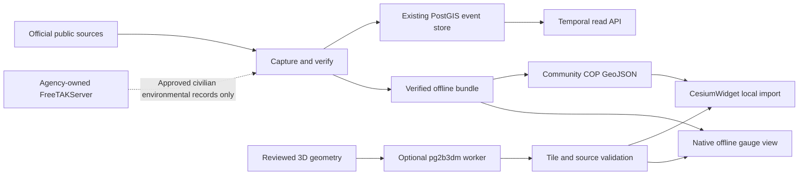

# Civilian community 4D digital twin — XRF, Scotland and Cesium research
Date: 2026-11-24. Scope: TSM, initially Mount Vernon and Posey County, then the configured eight-county region.

## Source-derived patterns, not claims of parity
- [Scotland national digital twin (2026-11-18)](https://cesium.com/blog/2026/11/18/national-digital-twin-supports-infrastructure-edu/): common geographic context for infrastructure, BIM/CAD, photogrammetry, public environmental readings and student projects.
- [XRF case study (2026-04-14)](https://cesium.com/blog/2026/04/14/xrf-connects-and-integrates-missions-with-cesium/), [XRF](https://www.xrf.ai/), [Cesium Community](https://community.cesium.com/t/xrf-connects-and-integrates-missions-with-cesium/45867): shared visual state across CesiumJS and Unity, interoperable 3D Tiles and multiple devices. XRF Compass and ion services are not open-source replacements.
- [VRAI (2025-11-24)](https://cesium.com/blog/2025/11/24/vrai-delivers-virtual-all-domain-environment-with-cesium/): transferable civilian principles are immersive terrain, high-fidelity context, weather/time-of-day and disconnected data delivery. TSM does not implement military targeting or command automation.
- [Cesium learning center](https://cesium.com/learn/) and [developer certification criteria](https://cesium.com/blog/2024/08/01/becoming-a-cesium-certified-developer/): demonstrate robust error handling, metadata styling, time-dynamic data, APIs, analysis and camera controls. This roadmap does not confer certification.

## Reuse current architecture

Existing services/living-twin/compose.yaml has pgSTAC/PostGIS, Redpanda, validated ingest, migrations, kernel, read projections, API, and observability. Do not add a second twin database. Source-authority, effective time, knowledge time, original bytes/hashes and observed versus modeled state are kept distinct. Local Windows uses files, not a localhost web server.



The dashed agency interface is **proposed**. No raw tactical/vehicle/individual tracks, private sensor locations, credentials or sensitive infrastructure are copied to the public viewer. A separate authorized deployment may use the upstream [FreeTAKServer Compose documentation](https://freetakteam.github.io/FreeTAKServer-User-Docs/Installation/mechanism/Docker/overview/) and an explicitly reviewed publication adapter; it is not installed or operated by this work. Do not connect it to the public event feed. Source claims from CoT cannot be treated as government-observed hydrology without independent provenance. Public USGS readings do not require TAK.

## Local execution

```sh
cd services/living-twin
docker compose up --build -d
docker compose --profile test run --rm tests
# Or headless local files (with requirements installed), without running Compose:
python -m twin.offline_bundle build /path/to/river-snapshot /path/to/new-bundle
python -m twin.community_cop /path/to/new-bundle /path/to/community-cop.geojson
node --test tests/test-community-cop.mjs
```

The scheduled river-evidence workflow is extended to export the verified bundle projection and SHA256SUMS. Download **both** the original river snapshot and the COP artifact, check its digest, and retain the original. Checksums detect byte changes but do not establish authentication or public release authorization. On the regional Cesium page open Scene controls > Community river observations, select the local GeoJSON. The scene shows separate gage labels and missing-station inventory. Browser imports are untrusted, source declarations are not independently verified there; recency is calculated using the clock on reopening and periodically. No file is uploaded or implicitly published. An unavailable source remains unavailable; no invented coordinates or water elevation.

### Optional PostGIS-to-3D Tiles Compose profile
Use [pg2b3dm upstream](https://github.com/Geodan/pg2b3dm) for already-reviewed **3D** geometry; current upstream documents the Docker image and connection-string CLI. The worker is opt-in, not a new database or a verified tileset. Before running, provision a dedicated read-only database principal scoped to a reviewed public 3D table with stable source IDs, finite nonempty geometry, known CRS, reviewed vertical reference, and approved source release. Set TSM_PG2B3DM_IMAGE to a locally verified version/digest, TSM_COP_TILE_CONNECTION to a local read-only connection string (do not commit it), TSM_COP_TILE_TABLE to the approved qualified table and TSM_COP_TILE_OUTPUT to a new empty writable output directory. These are local development settings, not a production secrets mechanism. No port is published by the tiler.

```sh
docker compose -f compose.yaml -f compose.cop-tiling.yaml --profile cop-tiling config -q
docker compose -f compose.yaml -f compose.cop-tiling.yaml --profile cop-tiling run --rm cop-tiler
```

Run existing 3D Tiles and offline integrity gates on generated content before copying to the public asset tree or native package. Geometry and metadata validation must include exact county coverage, CRS/vertical lineage, tile bounding volumes, per-feature identity, LOD errors, GLB resources, local references, no duplicate roof sets, and measured-versus-derived heights. Check storage budget and a headed camera/render test separately. Worker not executed or validated against a real 3D table in this PR.

### CesiumJS / TypeScript integration
The existing `cesium-live.mjs` implements a connected change-feed client; only use it on an authorized connected deployment with a reviewed read boundary. It is not the offline runtime. The new console uses `gaugeMarkers` from `tsm-console/src/lib/community-cop.mjs` and ground-clamped LabelCollection on CesiumWidget. The separate full Viewer adapter is `services/living-twin/community-cop.mjs`. For other already-loaded Viewer instances:
```js
import { showCommunityCop } from "./community-cop.mjs";
const document = JSON.parse(await file.text()); // bound file size before reading
const layer = await showCommunityCop({Cesium, viewer, document});
console.log(layer.stations); // list unavailable and unlocated series
// On unload: layer.dispose()
```
This is a presentation-only snapshot. A production HTTPS/WSS public environmental feed must first apply a strict publication allowlist, server-authenticated evidence, bounded messages and reconnect/replay semantics. The existing authorized connected client is a starting point, not a promise that every private event is safe for anonymous publication.

### Optional Unity C# georeference example
Use [CesiumGlobeAnchor](https://cesium.com/learn/cesium-unity/ref-doc/classCesiumForUnity_1_1CesiumGlobeAnchor.html) with a **reviewed ellipsoidal ground height**, not gage stage. If ground height is unavailable, omit the object or use an explicitly terrain-relative visualization. This code is a reference integration, not compiled Unity evidence:
```cs
using CesiumForUnity;
using System;
public static class PublicGaugeAnchor {
    public static void Place(CesiumGlobeAnchor anchor, double lon, double lat,
                             double? reviewedEllipsoidHeightM) {
        if (anchor == null || !reviewedEllipsoidHeightM.HasValue)
            throw new ArgumentException("Reviewed ellipsoid height required");
        double h = reviewedEllipsoidHeightM.Value;
        if (double.IsNaN(lon) || double.IsInfinity(lon) || lon < -180 || lon > 180 ||
            double.IsNaN(lat) || double.IsInfinity(lat) || lat < -90 || lat > 90 ||
            double.IsNaN(h) || double.IsInfinity(h))
            throw new ArgumentException("Invalid coordinate");
        anchor.SetPositionLongitudeLatitudeHeight(lon, lat, h);
    }
}
```
Use a separate text label for stage, units, observation time, quality and uncertainty. No real-time person or vehicle tracking is required for the public twin.

## Methods to implement and validate by discipline

| Discipline | Methods and independent acceptance |
|---|---|
| Geodesy | NAD83-based state plane, NAVD88 and reviewed GEOID18 conversion to ellipsoid heights, coordinate axis and unit tests, control-point residuals. Do not assume NAD83 and WGS84 are identical at survey precision. |
| Terrain | Official [USGS 3DEP](https://www.usgs.gov/3d-elevation-program/) and [Indiana GIO harvest](https://www.in.gov/gis/geoinsights/posts/data-releases-data-harvest-2025-and-imagery), point classification, DTM/DSM, hydrologic conditioning only as separately derived terrain, seam and no-data checks. |
| Reality capture | [OpenDroneMap GCP workflow](https://docs.opendronemap.org/gcp/), SfM bundle adjustment, independent check points, MVS, orthomosaic and texture atlas, LoD1 through verified higher LoD; record RMSE, absolute and relative accuracy, photos and rights. Do not upgrade appearance to measurement. |
| Buildings | Join authoritative footprint IDs to local ground and roof LiDAR; reject vertical ambiguity; reconcile 23,082 target vs published subset before countywide acceptance. |
| Data catalog | [STAC](https://www.ogc.org/standards/stac/) per asset/vintage; original hashes, source rights, collection, footprint, version history. [OGC SensorThings](https://www.ogc.org/standards/sensorthings/) for approved sensor observations; not claiming standards conformance. |
| Rendering | [OGC 3D Tiles 1.1](https://www.ogc.org/standards/3DTiles/), HLOD, screen-space error, glTF materials, metadata styling, [CZML](https://cesium.com/learn/cesiumjs/ref-doc/CzmlDataSource.html) time visualization, [Martin](https://maplibre.org/martin/) vector tile serving. |
| Hydrology | [USGS Water Data](https://api.waterdata.usgs.gov/), reviewed datum, HEC-RAS calibrated/withheld scenarios, no invented observation, model-vs-observation residuals, applicable FEMA and DNR layers separately. |
| Community education | Historical imagery comparisons, model-design imports, flood-scenario what-if exercises, water gauge time-series and infrastructure context; non-regulatory, sources and assumptions exposed. |
| Offline | Complete local asset manifest, explicit update pull, no WebView/Node/local service for native Windows, clean-network-disabled executable acceptance separate from code tests. |

## Milestones and evidence gates
1. Source observation COP: implemented exporter and viewer; synthetic tests do not replace real capture and rendering acceptance.
2. Connected authorized service: endpoint schema, privacy boundary, data versioning, source revision replay, availability monitoring. No direct FreeTAKServer coupling or public streaming of operational records.
3. Exact terrain and building inventory: independent coverage receipts, known vertical datum, deterministic tiles, source-to-render feature reconciliation.
4. Calibrated model and education workflow: independent validation with uncertainty, historical replay, model provenance and clear observed/scenario distinction.
5. Native Windows: package verified data, compile/cook/launch UE5.8 Shipping, headed visual evidence and offline no-network test on clean Windows 11.

All stages except visual QA are headless. Public access remains anonymous and free; agency systems have a separate authorization boundary. Human authority final.
