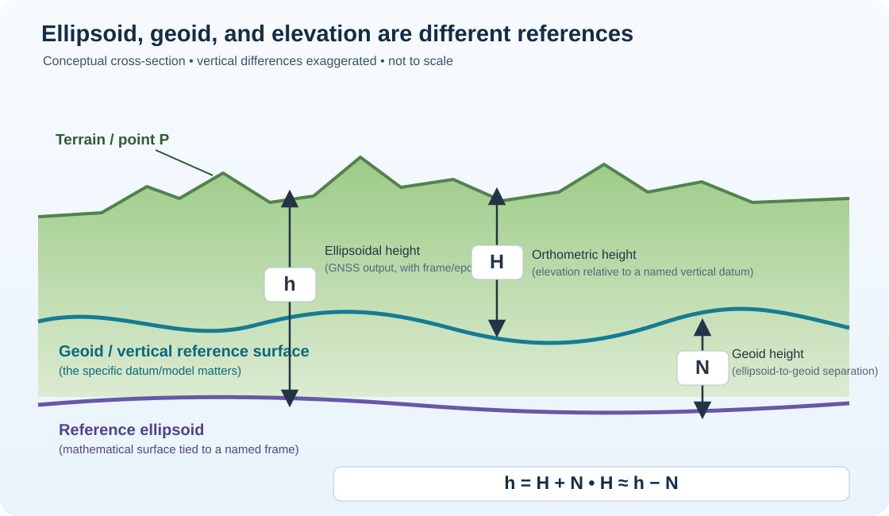

# TSM Geodetic Reference and USGS Topographic Sources

**Review date:** 2026-10-24  
**Contract:** `data/posey-county/government-evidence-boundaries-v1.json`  
**Scope:** geodetic metadata and map-reference controls for Posey County workflows; not a parcel/site AOI approval or an engineering determination.

## 1. Two distinct reference systems

| Concept | Question answered | Examples | Required metadata |
|---|---|---|---|
| Horizontal/geometric CRS and frame | Where is the point? | NAD 83 realizations, WGS 84/ITRF frames, State Plane projection | CRS, reference frame/datum, realization, epoch as applicable, units, transformation history |
| Vertical datum | What height/elevation is this, relative to what zero? | NAVD 88; legacy NGVD 29 | vertical datum, height type, units, source and effective date/edition |
| Gage datum | What is the reported water level relative to at this station? | USGS station's gage-specific reference | station ID, parameter/units, gage datum metadata and period of applicability |
| Geoid model | What separation connects compatible ellipsoidal height and vertical-datum elevation? | GEOID18 in its documented coverage/use case | model/version, compatible reference frame/realization/epoch, coverage, units, uncertainty |

Do not infer a vertical datum from a horizontal CRS or assume that a coordinate pair includes an authoritative elevation. NAD 27 may appear in older topographic products. Keep original source metadata and record coordinate transformations rather than relabeling coordinates.

## 2. Geoid vs. ellipsoid definition image

- **Ellipsoid:** a smooth mathematical reference surface attached to a specified geometric reference frame.
- **Geoid:** a gravity-related equipotential surface used in defining orthometric elevations. It is not a physical, perfectly smooth sphere.
- **Ellipsoidal height, h:** GNSS height relative to a named ellipsoid/reference frame.
- **Orthometric height, H:** elevation relative to a named vertical datum, such as NAVD 88 in CONUS.
- **Geoid height, N:** separation between the ellipsoid and compatible geoid model.

NGS presents the relation as `h = H + N`, rearranged `H ≈ h − N`. These equations are not permission to apply a universal constant offset. Datum/realization, epoch, geographic coverage, model version, units, and uncertainty all matter.

## 3. NOAA GEOID18 compatibility gate

The NOAA NGS GEOID18 technical page specifies GEOID18 for NAD 83 (2011), epoch 2010.00 ellipsoidal heights when deriving orthometric heights consistent with NAVD 88 in CONUS. It is not directly compatible with arbitrary WGS 84, ITRF, or other NAD 83 realizations. Where input coordinates are incompatible, use a documented, supported transformation path and record the transformation operation and version rather than assuming the results are interchangeable.

The NGS describes GEOID18 estimated uncertainty as a measure of model fit to the datum surface implied by control benchmarks, not a complete measure of NAVD 88 height accuracy. Account for GNSS ellipsoid-height uncertainty, geoid-model applicability and uncertainty, vertical datum limitations, and independent control. Do not claim survey-grade accuracy from the geoid model alone.

## 4. Modernized NSRS status

NGS's status page says NAPGD2022 and NATRF2022 beta public-feedback periods are complete. That milestone does not, by itself, mean the modernized NSRS is fully adopted for production. The same page identifies several transformation capabilities as pending beta releases. TSM must only switch production transformations after NGS formally announces adoption and the actual production tools/data support the required operation. Preserve legacy and modernized identifiers distinctly during transition.

## 5. USGS TopoView and US Topo collection

- [TopoView](https://ngmdb.usgs.gov/topoview/viewer/#4/39.98/-100.02) presents historical maps alongside the US Topo series. Retain edition/publication year and map identity.
- [USGS US Topo Map Collection](https://catalog.data.gov/dataset/usgs-us-topo-map-collection) is described as layered geospatial PDFs of 7.5-minute quadrangles with orthoimagery, roads, grids, geographic names, elevation contours, hydrography, boundaries, and related map features. Data delivery is through [The National Map](https://www.usgs.gov/the-national-map-data-delivery).
- The catalog reports metadata updated 2025-03-11 and map data last modified 2025-02-14. These timestamps are source-catalog metadata, not evidence that TSM has downloaded the map product or that every local county is covered by a validated snapshot.
- **Evidence class: cartographic reference only.** A map PDF, rendered contours, or a TopoView search result is not a substitute for a current bare-earth DEM, lidar-derived terrain, surveyed bathymetry, or authoritative vertical-control data. It can support context/history review and source discovery but must not be promoted to an engineering input without separate artifact, datum, coverage, resolution, and accuracy checks.

## 6. Required TSM behavior

1. Preserve horizontal CRS and vertical datum/height type as separate required metadata.
2. Block promotion when datum, reference frame realization, epoch, units, geoid model, or applicability is missing or incompatible.
3. Never infer NAVD 88 elevation from gage height or station altitude alone.
4. Never silently convert NGVD 29 to NAVD 88 or ellipsoidal height to orthometric height. Record model/tool/version, transformation path, geographic applicability, uncertainty, and independent validation.
5. Keep TopoView/US Topo records in `AVAILABLE_FOR_DISCOVERY_NOT_ACQUIRED` until actual data bytes, hashes, versions, and validation receipts exist.
6. County-level source research does not approve an AOI; site AOI remains `NOT_APPROVED`.

## Official sources

- [NOAA NGS — Datums and Reference Frames](https://geodesy.noaa.gov/datums/index.shtml)
- [NOAA NGS — NAD 83 horizontal/geometric datum](https://geodesy.noaa.gov/datums/horizontal/north-american-datum-1983.shtml)
- [NOAA NGS — GEOID18 technical details](https://geodesy.noaa.gov/GEOID/GEOID18/geoid18_tech_details.shtml)
- [NOAA NGS — NSRS modernization status](https://geodesy.noaa.gov/datums/newdatums/TrackOurProgress.shtml)
- [USGS — TopoView](https://ngmdb.usgs.gov/topoview/viewer/)
- [Data.gov — USGS US Topo Map Collection](https://catalog.data.gov/dataset/usgs-us-topo-map-collection)

No source acquisition, site AOI approval, datum transformation execution, or hydraulic model run is claimed by these contracts.
