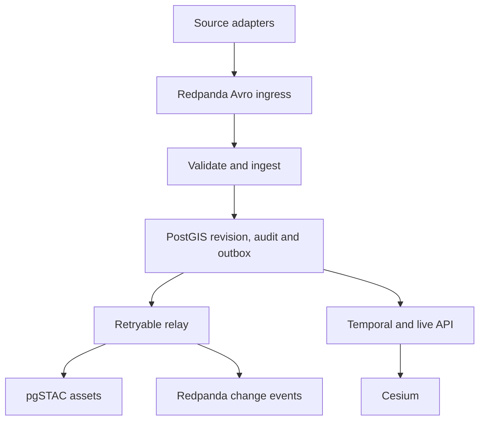

# Ohio–Wabash living twin runtime

This connected runtime stores state revisions as sparse PostGIS entities. It provides versioned Kafka ingestion, an append-only evidence graph, a retryable transaction outbox, pgSTAC publication, temporal snapshots, and a read-only Cesium change feed. Deploy it separately from the offline Windows desktop.



## Matrix identifiers

| Matrix | Identity and state |
|---|---|
| S | Spatial cell or feature ID, optional GeoJSON position, state class and attributes |
| O | Observation identity, sensor, parameter, value, unit, quality and vertical reference |
| H | Reach identity, optional stage, discharge, velocity, depth, width or volume |
| T | Tile or terrain identity, horizontal CRS, vertical datum and units |
| I | Infrastructure identity and asset type |
| B | Building identity and source OBJECTID |
| R | Reality-capture mission identity and capture ID |
| M | Simulation identity, model engine and revision |
| V | Validation identity, metric, sample count, units, withheld/fit/unknown and lineage |
| P | Provenance statement identity and artifact lineage |
| U | Uncertainty estimate identity, method and units |
| E | Evidence artifact or review identity and associated source |
| TT | Temporal context identity; all entities also use effective and knowledge time |
| RR | Community metric identity, community ID and method |
| SYNC | Source synchronization status identity and adapter cadence metadata |
| D | Human decision identity, reviewer, review time, disposition and evidence link |

Every record has an entity ID, matrix, timeline, branch, effective timestamp, source authority, source URI, retrieval timestamp and SHA-256. Geometry uses longitude and latitude in EPSG:4326. The state document gives the reference for any vertical measurements. Unknown states stay null or absent. A gauge stage is specific to its gauge reference and requires reviewed datum conversion before comparison to NAVD88 elevation. Assets and decisions enter from trusted, reviewed publishers. The runtime records their claims and never grants engineering or regulatory approval.

## Run and test

Use Docker with Compose v2. From this directory:

```sh
docker compose up --build -d
docker compose --profile test run --rm tests
```

The default development services bind exposed ports to loopback. The API is at `http://localhost:18000/docs`, Schema Registry at `http://localhost:18081` and Grafana at `http://localhost:13000/d/tsm-living-twin`. Prometheus scrapes bounded-cardinality service metrics. Tempo receives OTLP traces for API, ingestion and relay spans. W3C trace headers flow through Kafka and the outbox. Compose is a single-broker local deployment with fixed development credentials. For wider deployment, provide organizational TLS, network policy, credentials, Kafka ACLs, backups and a publication review before exposing any data.

Publish a validated JSON file with local Python dependencies and the default host ports:

```sh
python -m pip install -r requirements.txt
python -m twin.publish ./update.json
```

To replay an existing river pilot capture into the observation matrix, pass its extracted snapshot directory containing `manifest.json` and station GeoJSON files:

```sh
python -m twin.import_usgs ./river-snapshot
```

This importer verifies each source hash and preserves series, observation time, units and approval status. It preserves gauge-relative stage and emits stable UUIDs when replaying the same capture. Schedule it alongside the capture workflow when running a connected deployment.

Schema files are in `schemas/`. The wire codec validates with the JSON Schema and Avro schema, then uses Redpanda's registry and the Confluent wire format. The ingress and change subjects are `tsm.twin.state-update.v1-value` and `tsm.twin.state-change.v1-value`. Both use `FULL_TRANSITIVE`. Compatible wire changes add fields with defaults and preserve old names and types. Validate proposed changes against all deployed readers and writers. New timeline, matrix or operation semantics require a coordinated version bump when existing readers would reject them. Breaking changes use new topics, subjects and a documented migration.

The key is `timeline/branch/matrix/entity_id`. Ingress uses one partition in v1. Submit referenced evidence first so causal relationships have a deterministic ordering. The producer must reuse the same UUID and body on an ambiguous retry. Reuse of an ID with different content is rejected. The consumer acknowledges offsets after the database transaction or acknowledged dead-letter publication. A transient failure leaves the offset replayable. The JSON dead-letter contract preserves original topic, partition, offset and SHA-256 without copying source data.

Outbox dispatch is at least once. Consumers deduplicate change events by event ID. Outbox retries can reorder Kafka publication, so use the API's committed sequence for ordered replay. pgSTAC uses the event UUID as the immutable item ID and upserts the catalog item and delivery receipt together. The asset URI is retained as a locator. Publication does not download it or independently verify its asset hash. Separate delivery rows keep a Kafka failure from discarding pgSTAC work.

## Replay and spatial rendering

- `GET /v1/snapshot` resolves the latest visible revision for each identity at `valid_at` and `known_at`. Use the returned timestamps, watermark and pagination keys for subsequent pages. Late corrections preserve the earlier state at its original knowledge time. Retire events remove the entity from snapshots at and after the effective timestamp.
- `GET /v1/changes?after=0` pages the commit-ordered history. `WS /v1/live?after=<cursor>` resumes the same feed after a disconnect. Consumers store the last applied sequence. These APIs expose submitted data, so feed only public-authorized records to this instance.
- `GET /v1/cesium?bbox=-88.2,37.6,-87.4,38.4` returns GeoJSON for the observed timeline, with pagination and source provenance. `cesium-live.mjs` can bind an existing viewer to the feed. Set `CESIUM_ORIGINS` to the viewer origin when cross-origin access is required.
- The relay refreshes the indexed `twin.current_state` and `twin.matrix_counts` materialized views about every 15 seconds. The snapshot endpoint reads revision history directly.

The regional state schema can accept evidence from USGS, NOAA, FEMA, USACE, state agencies and reality capture. Continuous agency adapters, calibrated models, exact regional coverage and review policy remain separate inputs. A single health score is intentionally left to a reviewed metric definition with valid sample coverage and normalization.

## Schema changes and rollback

Run `alembic upgrade head` with `DATABASE_URL` set. The SQL sources are in `migrations/sql`. Use `alembic upgrade head --sql` to inspect the upgrade without connecting. `alembic downgrade base` removes the twin schema and its history while retaining shared PostGIS and pgSTAC. Run only on a database you intend to reset, or after backing up the twin schema. The integration suite tests downgrade on an isolated database.

## Twin State API and replay

The CQRS API runs separately at `http://127.0.0.1:18001/docs`. The original port 18000 API still serves raw event history. The kernel advances the current projection from committed PostGIS sequences. Compose provisions a dedicated API database login with read access and permission to insert rebuild requests only. Kafka delivery timing is independent of that checkpoint.

| Endpoint | Read model |
| --- | --- |
| `GET /twin/current/hydrology` | Current reach revisions and a separate list of latest gauge observations by sensor, parameter and series |
| `GET /twin/current/buildings`, `GET /twin/current/terrain` | Current entity revisions with optional EPSG:4326 bounding box |
| `GET /twin/current?matrix=V` | Current records by matrix, including validation and simulation results |
| `GET /twin/time/{valid_at}` | Effective-time replay with optional knowledge time, timeline, branch and bounds |
| `GET /cesium/live/{layer}?bbox=...` | Projected GeoJSON for buildings, hydrology or infrastructure |
| `WS /twin/live?after={seq}` | Ordered commit notifications through the projection watermark |

Current responses include `watermark`, `view_version` and `next_after`. Send both `next_after` as `after` and `view_version` on the next request. A 409 means the view changed, so restart from page one. The WebSocket sends committed revisions as invalidations. Reload the appropriate projection after an update because a late historical revision may leave current state unchanged. Redis caches results by the projection instance, generation, and sequence. The state API reads from PostGIS if Redis is unavailable.

The projection is idempotent by committed event sequence. Within each observed identity, later effective time wins and the higher commit sequence breaks effective-time ties. Tombstones prevent a late older record from resurrecting a retired entity. Forecast and scenario results remain queryable through time travel in their own timelines. Gauge observations retain their original units, quality, and datum reference.

For local rebuild operations, set a secret `TWIN_REBUILD_TOKEN` before starting Compose. Rebuild endpoints are disabled when it is unset. The admin POST and status requests require `Authorization: Bearer ...`. A POST also requires an `Idempotency-Key` header containing a UUID.

```sh
curl --fail -X POST http://127.0.0.1:18001/rebuild/projections \
  -H "Authorization: Bearer $TWIN_REBUILD_TOKEN" \
  -H "Idempotency-Key: $(uuidgen)"
```

Poll `GET /rebuild/jobs/{job_id}` with the same authorization. Projection rebuilds replace the projection and checkpoint in one transaction. Readers see the previous complete state until the rebuild commits. `POST /rebuild/stac` requeues the existing asset revisions for pgSTAC via the existing outbox. A completed STAC rebuild job means requeueing committed. The relay performs catalog delivery asynchronously. The job status reports the number of pending deliveries through its captured watermark. Rebuilds do not write source events or create Kafka messages. Use a fresh UUID for a new rebuild and reuse the original UUID for request retries.

The kernel coordinates replay and projection. The existing ingress consumer owns event writes, and the existing relay owns Kafka and pgSTAC delivery. Simulation and validation workers can publish results through the existing event contract. This service does not launch HEC-RAS or adjudicate engineering decisions.


## Phases 1–3: canonical state, hydrologic validation and infrastructure asset shells

The connected living-twin service is headless. It is isolated from the native
Windows offline runtime, which must not depend on HTTP, Redpanda, Redis or a
local server. PostGIS is the sole authoritative event store; all read models,
validation records, and AAS documents are projections or derived evidence.

### Canonical state and replay

The CQRS state API exposes current typed state and temporal reconstruction:
GET /twin/current?matrix=I, GET /twin/time/{valid_at}, and live changes.
Transactions are tracked by committed sequence and versioned by effective and
recorded time. State and projection rebuild behavior is exercised by the
Compose integration tests. Historical inputs must never be overwritten.

### Hydrology: O observation + H model prediction -> V evidence record

Use the source-hashed river snapshot importer to retain USGS observation time,
unit, approval status, time-series identity, SHA-256, and unresolved gage datum:

    python -m twin.import_usgs ./river-snapshot

The allowed river pilot stations are USGS 03322000, 03378500, and optional
03377500, when present in the snapshot manifest. The source remains the
official USGS OGC Water Data API. The importer does not invent readings.

Publish an H model event using the existing twin.publish operator tool with
timeline forecast/scenario, a unique non-main branch, source provenance, H
state.reach_id, state.station_id (e.g. USGS-03378500), state.stage_ft for a
predicted NAVD88 water-surface elevation in feet, state.unit = ft, and
state.vertical_reference = NAVD88. Preserve run ID, model revision and original
HEC-RAS input/output evidence. Never label model output as an observation.

Compare exact stored O and H event UUIDs and publish a validation record:

    python -m twin.validate_hydrology --observation OBS_UUID \
      --prediction MODEL_UUID --gage-zero ./reviewed-zero.json \
      --validated-at 2026-11-22T07:00:00Z

Reviewed station-specific gage-zero JSON requires station_id, offset_ft,
datum=NAVD88, reviewed=true, uncertainty_ft, evidence_uri (HTTPS),
sha256, effective_from, and effective_to. The reviewed flag is an operator
attestation only: the code DOES NOT independently check that the URL's content
matches its supplied SHA-256. Independently audit the dated official datum
source and offset before marking it reviewed.

Without that evidence the comparison returns WITHHELD/GAGE_ZERO_UNREVIEWED;
with unit/station/time disagreement it also withholds, rather than making a
false 0.2-foot residual claim. Successful comparisons report model-minus-
observation residual, absolute error, optional propagated uncertainty, and
source digests. If observation or model uncertainty is missing, combined
uncertainty remains null. A V record links the O and H events immutably; the
operator must explicitly classify model calibration use as fit, withheld, or
unknown. The default unknown is not independent validation certification.

### Infrastructure versioning and AAS projections

Manifest JSON must contain asset_id (UUID), asset_type, name, version,
valid_from and verified source provenance. Supported types are bridge,
levee, gauge, pump_station, road, port. Optional fields include GeoJSON
EPSG:4326 geometry, properties and typed relationships such as connected_to,
part_of, crosses, upstream_of, protects and monitors. All source and
relationship assertions require independent field or agency verification.

    python -m twin.import_assets reviewed-asset.json --aas-preview
    python -m twin.import_assets reviewed-asset.json

The first command previews the AAS-shaped projection without writing to the
event store; the second commits an auditable I event. Read current state via:

    GET /twin/assets/{uuid}
    GET /twin/assets/{uuid}/relationships
    GET /twin/assets/{uuid}/aas

AAS output contains an AssetAdministrationShell, asset information, a
referenced infrastructure Submodel, properties and relation references.
Its conformance status is explicitly AAS_SHAPE_ONLY_NOT_INDEPENDENTLY_
CONFORMANCE_TESTED. A real BaSyx/IDTA schema and profile interoperability
test remains necessary before declaring the export standard compliant.

### Acceptance boundaries

Run the integration suite in a development Compose environment:

    docker compose --profile test run --rm tests

The suite now exercises deterministic residuals and withheld datum states,
duplicate-safe versioned infrastructure events, historical state, AAS endpoint
readback, and evidence links for V records. Tests use synthetic records and
offsets, not a verified real-time gauge reading or an accepted hydraulic
model. The independent release gates remain: authoritative USGS/USACE datum
verification, real HEC-RAS output integration and uncertainty review,
published infrastructure inventory coverage, AAS conformance, production
database operations, and clean offline UE5.8 Win64 Shipping proof.


## Phase 4 geospatial indexing and Phase 5 independent evidence

Run python -m twin.import_geospatial source-layer.json --preview before
publishing reviewed geometry/3D Tile/parcel/terrain/floodplain source links.
The matrix E link records EPSG:4326 geometry, native source CRS, vertical
datum/units, source feature identity, source SHA-256, upstream event IDs,
optional artifact checksum and reviewed or unresolved transformation status.
No silent CRS transformation or synthetic building height creation occurs.
GET /twin/geospatial?bbox=west,south,east,north&kind=3d_tiles is a bounded
GiST-indexed read-only API. Links with assets are cataloged through pgSTAC.

For release gates and commands see
docs/release/TSM-TWIN-PHASES-1-5-ACCEPTANCE.md.
Synthetic integration tests are not proof of a real countywide
building inventory or clean Windows 11 UE5.8 offline executable launch.


## Verified USGS capture to native offline observation handoff

The continuous river pilot produces an immutable capture manifest with
exact station response bytes, UTC window, station status and SHA-256. The
importer checks every captured row before publishing any event; malformed
station/parameter/units/timestamps, duplicate observations or incomplete
source pagination invalidate the capture. USGS no-data sentinels stay null.

In services/living-twin (with Python requirements installed):

    python -m twin.import_usgs /path/to/capture --preview
    python -m twin.import_usgs /path/to/capture
    python -m twin.offline_bundle build /path/to/capture /path/to/new-local-data
    python -m twin.offline_bundle verify /path/to/new-local-data
    pytest -q tests/test_usgs.py tests/test_offline_bundle.py

The first command does NOT connect to Kafka. The second command publishes
validated O events to the connected Redpanda/Kafka ingress. The two offline
commands need no Kafka/network/server; they produce original source files,
deterministic observation events and SHA-256 receipts. They do not claim
USGS authenticity, NAVD88 WSE, source-data licensing approval, HEC-RAS
calibration, public publication clearance or native UE5.8 Shipping.
See docs/architecture/USGS-TO-NATIVE-OFFLINE-HANDOFF-2026-11-22.md.
